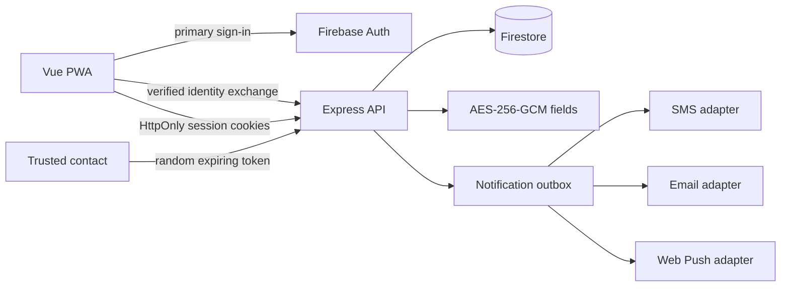

# Guardify

Guardify is a consent-first safety coordination PWA for SOS alerts, trusted contacts, expiring live-location sharing, safe journeys, check-ins, and private incident history. It is designed for mobile use and Bangladesh defaults, with English and Bangla interfaces.

> Guardify is an assistive tool, not a guaranteed emergency service. Connectivity, GPS, browsers, and notification providers can fail. In Bangladesh, call **999** for police/fire/ambulance and **109** for the women and children helpline when appropriate.

## What is implemented

- Firebase email identity with server-side verification and email-verification enforcement.
- Short application access sessions plus rotating, hashed refresh credentials, reuse detection, device revocation, logout, and logout-all.
- Owner-scoped API authorization and tested cross-user denial.
- Up to 10 encrypted emergency contacts with one-time opt-in and opt-out tokens.
- Idempotent SOS with encrypted location, expiring tracking link, delivery state, safety PIN and silent duress PIN behavior.
- Consent-bound live sharing with visible active state, explicit audience, expiry, revocation, acknowledgement, and global kill switch.
- Safe journeys, scheduled check-ins, incident history, JSON export, erasure, abuse reports, fake-call UI, quick exit, and Bangladesh emergency numbers.
- Installable offline-shell PWA with queued SOS replay, route-split bundles, dark mode, large-text responsiveness, and reduced-motion support.
- Fail-fast configuration, redacted logs, strict schemas, CSP/Helmet, exact-origin CORS, body/rate limits, health/readiness, and graceful shutdown.
- Non-root multi-stage Docker image, Railway configuration, GitHub Actions, CodeQL, gitleaks, Dependabot, and coverage gates.

Provider credentials are deliberately not bundled. Twilio SMS and Resend email adapters activate only when their complete environment settings are present. Web Push remains disabled until the owner supplies a VAPID-capable provider implementation. Disabled channels record `pending_provider_configuration`; the UI never claims that an alert was delivered.

## Architecture



See `docs/ARCHITECTURE.md` and `docs/THREAT_MODEL.md`.

## Screenshots

Staging screenshots are intentionally placeholders until the owner completes the privacy-safe mobile QA pass: dashboard/SOS, contact consent, live tracking, journey/check-in, and Bangla/dark-mode views. Do not capture real names, phone numbers, or coordinates.

## Prerequisites

- Node.js 22+
- npm 11+
- A Firebase project with Email/Password Auth and Firestore
- Docker Desktop (optional)

## Quick start

1. Copy `backend/.env.example` to `backend/.env` and `frontend/.env.example` to `frontend/.env`.
2. Generate a session secret and 32-byte data key. Never reuse keys between staging and production.
3. Configure Firebase Application Default Credentials or store the service-account JSON only in `FIREBASE_SERVICE_ACCOUNT_KEY` in the local secret file/platform secret store.
4. Install and verify:

```bash
npm install
npm run install:all
npm run verify
```

5. Start both services:

```bash
npm run dev
```

Open `http://localhost:5173`. Set `VITE_API_URL=http://localhost:5000/api/v1` for local development.

For the combined container, populate `backend/.env` and the `VITE_FIREBASE_*` shell variables, then run:

```bash
docker compose up --build
```

Open `http://localhost:5000`.

## Configuration

| Variable                                                            | Scope     |      Required | Purpose                                                                    |
| ------------------------------------------------------------------- | --------- | ------------: | -------------------------------------------------------------------------- |
| `APP_ORIGINS`                                                       | API       |           yes | Exact comma-separated browser origins; no production wildcard.             |
| `PUBLIC_APP_URL`                                                    | API       |           yes | Base URL used in opt-in and tracking links.                                |
| `SESSION_SECRET`                                                    | API       |           yes | At least 32 characters; separate per environment.                          |
| `DATA_ENCRYPTION_KEYS`                                              | API       |           yes | `keyId:base64-32-byte-key`, comma-separated for rotation.                  |
| `DATA_ACTIVE_KEY_ID`                                                | API       |           yes | Key ID used for new ciphertext.                                            |
| `FIREBASE_PROJECT_ID`                                               | API       |           yes | Firebase/GCP project.                                                      |
| `FIREBASE_SERVICE_ACCOUNT_KEY`                                      | API       |   conditional | Service-account JSON when workload identity is unavailable.                |
| `LOCATION_RETENTION_DAYS`                                           | API       |            no | Default 30; allowed 1–365.                                                 |
| `SHARE_DEFAULT_TTL_MINUTES`                                         | API       |            no | Default 120; allowed 5–1440.                                               |
| `VITE_API_URL`                                                      | PWA build |           yes | API base, normally `/api/v1` in the combined image.                        |
| `VITE_FIREBASE_*`                                                   | PWA build |           yes | Public, domain-restricted Firebase Auth configuration.                     |
| `SMS_PROVIDER`, `SMS_API_KEY`, `SMS_ACCOUNT_SID`, `SMS_FROM_NUMBER` | API       |   conditional | Set provider to `twilio`; use a restricted auth token and verified sender. |
| `EMAIL_PROVIDER`, `EMAIL_API_KEY`, `EMAIL_FROM`                     | API       |   conditional | Set provider to `resend`; use a restricted API key and verified sender.    |
| `WEB_PUSH_*`                                                        | API/PWA   | launch action | Reserved VAPID settings; Web Push is not yet wired.                        |

## Commands

| Command             | Purpose                                                      |
| ------------------- | ------------------------------------------------------------ |
| `npm run dev`       | Start API and PWA development servers.                       |
| `npm run lint`      | Lint backend and frontend.                                   |
| `npm run typecheck` | Strict TypeScript/Vue checks.                                |
| `npm test`          | Unit, integration, component, security, and coverage suites. |
| `npm run build`     | Build API and PWA.                                           |
| `npm run audit`     | Fail on high/critical production dependency findings.        |
| `npm run verify`    | Run the complete local quality gate.                         |

## Testing and security

Backend tests use an in-memory persistence adapter and fake identity verifier, never production credentials. They cover token rotation/reuse, IDOR denial, strict validation, encrypted fields, SOS replay, consent links, sharing lifecycle, provider failure isolation, retention, privacy erasure, journeys, check-ins, and admin boundaries. Playwright covers public sharing, expiry, and denied location permission.

Run history scanning separately because the inherited Git history may contain exposed credentials:

```bash
gitleaks git --redact --report-path .gitleaks-report.json
```

Follow `SECRETS_ROTATION.md` before deployment. Deleting a secret from the current tree does not revoke it or remove it from history.

## Deployment

The root Dockerfile builds one immutable image containing the API and PWA. Railway uses `/readyz` as its health gate. Create separate staging and production environments, set secrets independently, deploy Firestore rules/indexes, test staging, then promote the exact image digest. See `docs/RUNBOOK.md`.

## Known launch blockers

- The owner must rotate inherited secrets and deploy deny-by-default Firestore rules/indexes.
- Twilio/Resend credentials, verified sender identities, spend caps, webhook monitoring, and live delivery drills require owner-selected provider accounts; Web Push still requires implementation and VAPID device testing.
- Browser background execution and Web Push vary by platform; native power/volume-button triggers are not available to a normal PWA.
- Launch still requires a staging restore test, provider sandbox drills, ZAP against staging, Lighthouse evidence, and human assistive-technology testing.

## License and conduct

MIT licensed. See `LICENSE`, `CONTRIBUTING.md`, `CODE_OF_CONDUCT.md`, and `SECURITY.md`.
