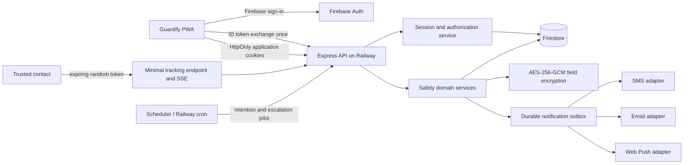

# Guardify architecture

## Baseline

The repository contained a Vue 3/Vite browser application using Firebase Auth and direct Firestore reads/writes. A small Express/Firebase Admin server separately wrote to Realtime Database. No coherent authorization boundary connected the two data stores.

## Target architecture

## Trust boundaries and data flow

1. Firebase verifies primary user credentials and email/phone verification.
2. The API verifies the Firebase ID token, creates an application session, and sends secure cookies. The browser never stores application tokens manually.
3. Every protected query is scoped by the server-derived user ID. Admin access requires a server-verified custom claim/role, never a browser field.
4. Contact details and precise coordinates are encrypted before Firestore. Logs contain only event IDs and coarse outcomes.
5. Share and opt-in links contain high-entropy random tokens. Only token hashes are stored; links expire and can be revoked.
6. SOS creates an immutable incident plus durable notification jobs in one service operation. An idempotency key prevents accidental duplicates.
7. Public live updates use a capability-scoped SSE stream with heartbeat, backpressure handling, expiry/revocation checks, and no account token or PII in the URL.

## Availability and degradation

- The PWA stores a minimal encrypted-at-rest-by-browser queued SOS request for retry when offline; the UI clearly states that an offline alert has not been delivered.
- Notification adapters attempt configured channels independently and record delivery status. Failure of one channel does not suppress the others.
- Outbox destinations are encrypted; only unsent channels remain queued. Transient failures back off exponentially and stop in a visible dead-letter state.
- Public tracking pages expose only the active share, never account/contact details, and return `noindex`, `no-store`, and a restrictive CSP.
- Health checks distinguish process liveness from readiness of required external services.
